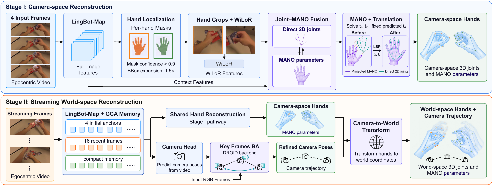

# InfiniHand: Streaming World-Space Hand Motion Estimation from Egocentric Video

[](https://infinihand.github.io/)
[](https://arxiv.org/abs/2609.35743)
[](https://infinihand.github.io/#demo)

[Kerui Ren](https://scholar.google.com/citations?user=5kW5apkAAAAJ), Kaiwen Song, Weiguang Zhao, Yuxi Wang, Yufei Liu, [Bo Dai](https://daibo.info/), Haoyu Guo, Chunhua Shen, [Mulin Yu](https://scholar.google.com/citations?user=w0Od3hQAAAAJ), [Tao Lu](https://scholar.google.com/citations?user=Ch28NiIAAAAJ), Junting Dong

## Pipeline

InfiniHand estimates hand masks, camera-space MANO parameters and camera motion from egocentric RGB video. Streaming geometric features and hand-centered appearance are fused for hand reconstruction; camera poses transform the hands into a shared world frame. Optional sparse bundle adjustment refines the trajectory.



- **Stage I:** train mask and MANO reconstruction branches on short clips.
- **Stage II:** continue training the MANO and mask branches on longer clips and train the camera head. The camera head is trained only in Stage II.
- **Inference:** predict masks, hands and cameras, optionally refine cameras with sparse BA, and export camera-space and world-space geometry.

Training (`infinihand.train`) and inference (`infinihand.infer`) have separate entry points and share the model definitions.

## Environment setup

Requirements: Linux, Python 3.11, an NVIDIA GPU, and a CUDA-compatible PyTorch installation. CUDA extensions additionally require the CUDA toolkit and a C++ compiler.

```bash
git clone https://github.com/infinihand/InfiniHand.git
cd InfiniHand
conda create -n infinihand python=3.11 -y
conda activate infinihand
python -m pip install torch==2.6.0 torchvision==0.21.0 --index-url https://download.pytorch.org/whl/cu124
python -m pip install -r requirements.txt
python -m pip install -e . --no-deps
```

For sparse BA, build the bundled DROID and LieTorch extensions:

```bash
python -m pip install --no-build-isolation ./third_party/droid
```

Obtain the licensed [MANO](https://mano.is.tue.mpg.de/) models and WiLoR's `mano_mean_params.npz`. Place them in `/path/to/weights/mano/`. Training expects `mano_data` under the configured WiLoR root to point to that directory. Follow the third-party terms in [NOTICE.md](NOTICE.md).

All external paths in the configurations are `/path/to/...` placeholders. Replace them before running. Set `lingbotmap_root`, `wilor_root`, and `wilor_cfg` to the bundled implementations in your checkout; set the MANO, data, checkpoint, cache and output locations to your installation.

## Inference

Download the inference checkpoint from [Hugging Face](https://huggingface.co/cskrren/InfiniHand):

```bash
mkdir -p /path/to/weights
curl -L https://huggingface.co/cskrren/InfiniHand/resolve/main/inifinihand_v1.pt \
  -o /path/to/weights/inifinihand_v1.pt
```

Edit `configs/infinihand_v1.json`, including `mano_model_path`. The checkpoint contains the learned backbone and Mask/MANO/Camera weights; licensed MANO assets are loaded separately. Prepare intrinsics for the original video resolution:

```json
{"fx": 700.0, "fy": 700.0, "cx": 640.0, "cy": 360.0, "image_width": 1280, "image_height": 720}
```

Run feed-forward inference with the learned mask head:

```bash
python -m infinihand.infer \
  --video /path/to/video.mp4 --intrinsics /path/to/intrinsics.json \
  --config /path/to/InfiniHand/configs/infinihand_v1.json \
  --checkpoint /path/to/weights/inifinihand_v1.pt \
  --mask-source head --no-ba --output /path/to/outputs/demo
```

To enable sparse BA, omit `--no-ba` and supply `--droid-weights /path/to/weights/droid.pth`. The default BA mode uses a binary keyframe pool; `--ba-mode fixed` selects fixed-stride refinement. Optional SAM3 tracking uses `--mask-source sam3` and the assets described in [the inference guide](docs/INFERENCE.md).

Outputs include `camera_space.npz`, `world_space.npz` and `SUCCESS.json`; BA also writes `trajectory.npz`. Hand slots are right, left. Use a fresh output directory. Each invocation accepts 4–8192 frames; BA runs after feed-forward prediction. World coordinates use the predicted camera scale.

## Training

Prepare unified scene manifests and set `dataset_jsons` and `sampling_weights` in `configs/training/`. All training manifests must declare `split: train`. See [the data format](data/README.md) for the manifest and geometry requirements. Place official LingBot-Map and WiLoR initialization weights at the configured paths.

### Training Stage I

Stage I trains the MANO and mask branches on four-frame clips. Train the MANO branch, then initialize the mask branch from the same complete base written by that run:

```bash
python -m infinihand.train --config /path/to/InfiniHand/configs/training/stage1_mano.yaml \
  --set output_dir=/path/to/runs/stage1_mano
python -m infinihand.train --config /path/to/InfiniHand/configs/training/stage1_mask.yaml \
  --set finetune_checkpoint=/path/to/runs/stage1_mano/initial_model.pt \
  --set output_dir=/path/to/runs/stage1_mask
```

### Training Stage II

Stage II uses 36-frame clips to continue training the MANO and mask branches and to train the camera head. MANO and mask each have Stage I and Stage II configurations; the camera head has only a Stage II configuration. Set `finetune_checkpoint` to a complete Stage I checkpoint containing the trained MANO and mask weights:

```bash
for task in mano mask camera; do
  python -m infinihand.train \
    --config /path/to/InfiniHand/configs/training/stage2_${task}.yaml \
    --set finetune_checkpoint=/path/to/weights/stage1.pt \
    --set output_dir=/path/to/runs/stage2_${task}
done
```

Batch size is per process; global batch size follows the number of processes. For distributed training, replace `python -m infinihand.train` with `torchrun --standalone --nproc_per_node=8 -m infinihand.train`. Use `--check-config` to validate training manifests and initialization paths before launching. Resume by supplying the run's complete base as `finetune_checkpoint` and its partial update as `resume_checkpoint`; the trainer restores optimizer and scheduler state.

## Acknowledgement

We thank the authors of [LingBot-Map](https://github.com/Robbyant/lingbot-map), [WiLoR](https://github.com/rolpotamias/WiLoR), [HaWoR](https://github.com/ThunderVVV/HaWoR), and [ViDiHand](https://github.com/NTUYWANG103/ViDiHand) for their excellent work and contributions to the research community.

## Contact and citation

For questions, contact [Kerui Ren](mailto:renkerui@sjtu.edu.cn). Please cite our paper:

```bibtex
@article{ren2026infinihand,
  title={InfiniHand: Streaming World-Space Hand Motion Estimation from Egocentric Video},
  author={Ren, Kerui and Song, Kaiwen and Zhao, Weiguang and Wang, Yuxi and Liu, Yufei and Dai, Bo and Guo, Haoyu and Shen, Chunhua and Yu, Mulin and Lu, Tao and others},
  journal={arXiv preprint arXiv:2609.35743},
  year={2026}
}
```
